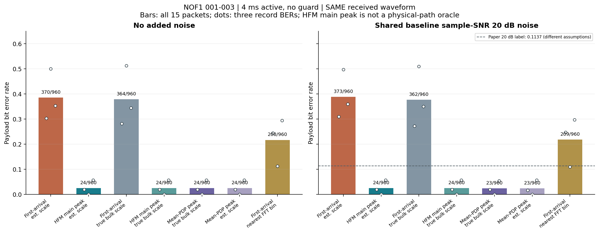
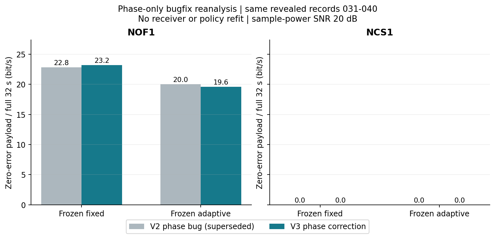
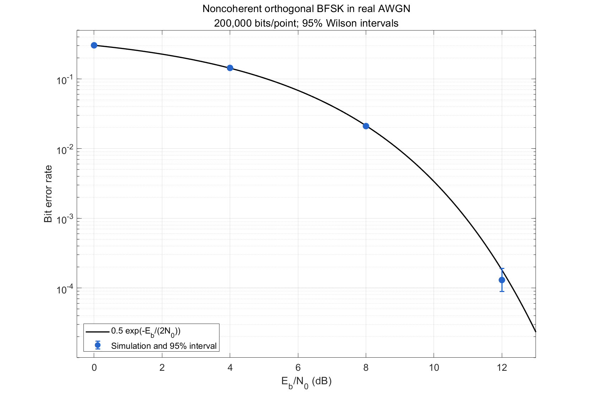

# 水声 BFSK 论文复现与接收定时诊断

围绕 Schmidt 等（2024）*Performance of low-power underwater modem for shallow water communications*，实现非相干 BFSK、HFM 前导捕获、多普勒尺度补偿及保护时间实验，并使用 Watermark 实测时变信道检验结果。项目保留原始计数、冻结策略、修正记录和负结果，重点解释接收实现为什么偏离论文。

**Abstract.** This repository presents a partial reproduction and diagnostic study of low-power underwater BFSK communication using measured Watermark channels. Paired waveform experiments identify a timing–phase interaction behind a large BER discrepancy. A frozen adaptive guard-time policy does not outperform the fixed baseline in the corrected continuous-scheduling experiment. The work is simulation-based and AI-assisted; it is not an exact full-paper reproduction or a hardware validation.

## 主要结果

| 实验 | 结果 | 能支持的结论 |
|---|---|---|
| NOF1，4 ms、无保护，开发记录 001–003 | 同一收到波形上的错误数 **373/960 → 24/960**（38.85% → 2.50%） | 将最早显著前导峰定时改为联合检测主峰，能解释本实现的大部分异常；尺度、噪声和检测器保持不变 |
| 固定候选规则，记录 004–005 确认 | **163/640 → 59/640** | 改善在另一组开发记录上出现，但记录 004 仍有 59/320 个错误；这些记录已用于开发，不是新的独立最终测试 |
| 修正初相后的连续排程，记录 031–040 | 固定 **11.6 bit/s**，自适应 **9.8 bit/s** | 未证明自适应优势；每条记录以完整 32 s 为分母，共 595 帧，NCS1 两策略均无完整无错包 |

连续实验修复了循环变量 `pi` 遮蔽数学常量造成的初相差异，保留原冻结接收器和策略。修正值替代旧的 11.4/10.0 bit/s；这次是已查看记录的错误修正重分析。上述主峰定时候选尚未并入连续实验接收器。







## 结果与代码入口

- [NOF1 配对诊断与确认实验](results/v3/nof1_diagnostic/report.md) · [连续排程修正报告](results/v3/continuous_phase_corrected/correction_report.md) · [原论文对齐与 FFT 诊断](results/v2/paper_alignment/report.md)
- [运行与阅读指南](docs/v2_run_guide.md) · [论文参数核验](docs/paper_audit.md) · [预定自适应协议](docs/adaptive_protocol_v2.md)

| 目录 / 文件 | 内容 |
|---|---|
| [`matlab/+uac`](matlab/+uac) | BFSK 基础收发、快速时变信道回放 |
| [`matlab/+uac2`](matlab/+uac2) | 帧格式、HFM 捕获、导频尺度估计与载荷解调 |
| [`matlab/run_nof1_diagnostic_v3.m`](matlab/run_nof1_diagnostic_v3.m) | 同波形消融、定时扫描、004–005 固定规则确认 |
| [`matlab/run_continuous_phasecheck_v3.m`](matlab/run_continuous_phasecheck_v3.m) | 使用冻结策略的初相修正连续复跑 |
| [`tools`](tools) / [`results`](results) | 分析与报告脚本 / 逐包 CSV、元数据、冻结清单和图表 |

## 快速复跑

只核验已发布结果时，无需 MATLAB 或原始信道数据：

```sh
python tools/verify_public_release.py
```

验证环境为 **MATLAB R2020b + Signal Processing Toolbox、Python 3.13.5**；Python 分析使用 NumPy、Pandas、Matplotlib。从仓库根目录安装已验证的版本：

```sh
python -m pip install -r requirements.txt
```

先在 MATLAB 中运行不需要 Watermark 数据的收发机检查：

```matlab
addpath('matlab');
run_awgn_validation;
validate_receiver_v2;
```

**Watermark 原始数据不随仓库发布。** 请按 [数据获取指南](docs/DATA.md) 从 Watermark 官方单独下载并准备 `vendor/Watermark` 目录。NOF1 诊断使用 001–005，连续复跑另需 NOF1/NCS1 031–040。数据就绪后：

```matlab
run_nof1_diagnostic_v3('full');
run_nof1_diagnostic_v3('confirmation');
```

```sh
python -X utf8 tools/report_nof1_diagnostic_v3.py
python tools/portable_reports.py
```

完整开发、冻结、测试及连续复跑顺序见 [运行指南](docs/v2_run_guide.md)。保留既有冻结文件与结果副本；重新拟合后，已经查看的记录不能再称为未见测试数据。

## 范围与归属

这是 **BFSK 部分复现及接收机扩展**，未精确复现原论文全部表格；原文未充分披露的检测、定时和噪声约定均需单独说明。样本功率 SNR 与 Eb/N0 不可直接等同。连续实验采用理想反馈预算，无错载荷由离线真值统计，尚未实现 CRC/ARQ、真实回传链路、MCU 移植、水池试验或实测功耗。

代码实现、实验分析与审查使用了 **AI 协助**；本仓库不将这些成果表述为作者已独立完成全部工作。可核验依据是公开源码、随机种子、逐包计数和完成状态，跨海域泛化与硬件性能仍待验证。

论文作者为 Jan H. Schmidt、Iwona Kochańska、Aleksander M. Schmidt：[原文](https://doi.org/10.21008/j.0860-6897.2024.2.07)。Watermark来自[FFI官方项目](https://www.ffi.no/en/research/watermark)。表格转录、回放内核来源及许可边界见 [THIRD_PARTY.md](THIRD_PARTY.md)；路径清理和历史/公开哈希的区别见 [公开快照说明](docs/PUBLICATION.md)。
