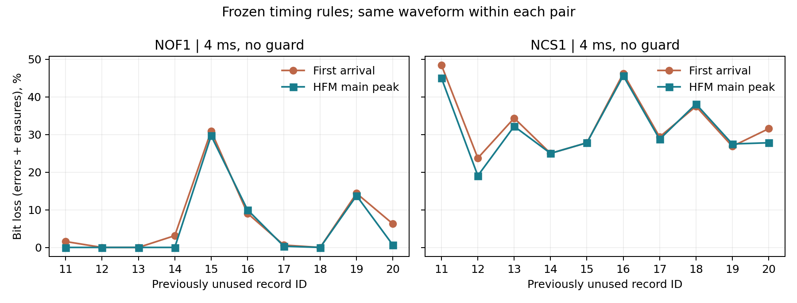

# 水声 BFSK 复现笔记

一条水声消息在两个符号之间多等几毫秒，能减少多少错误？这份复现从这个问题开始：搭起 BFSK 收发链路，接入实测水声信道，再比较保护时间带来的可靠性和速度变化。

起点是 Schmidt 等的 [2024 年低功耗水声 Modem 论文](https://doi.org/10.21008/j.0860-6897.2024.2.07)。目前完成的是其中 BFSK 部分的复现与接收机扩展，使用 MATLAB 和 [Watermark 实测信道回放](https://www.ffi.no/en/research/watermark)，尚未做水下硬件实验。

链路跑起来后，最值得追查的问题出在接收端：**已经找到了前导，为什么数据仍然判错？** 在几条开发记录里，把判断每个比特的窗口往后挪约 1 ms，误码率就变了很多。换一批未参与开发的记录后，改善却小得多。这个差异成了目前的研究重点。

复现过程中定下的一条取舍是：**先把基线偏差的原因弄清楚，再改进自适应策略。** 下面按这条线索介绍已有发现，以及还没解释清楚的部分。

## 已经找到前导，为什么还会判错

在 NOF1 的 4 ms、无保护配置中，最初接收器采用“最早显著前导峰”定位。开发记录 001–003 上的误码率达到 38.85%。为了查清原因，实验保持收到的波形不变，分别替换时间尺度、接收窗口和检测方式。

单独换成已知的整体多普勒尺度，误码率仍为 37.71%；沿用原尺度，只改为前导主峰对应的窗口，误码率降到了 2.50%。这些样本把排查方向指向了**载荷判决窗口**。

这里的细节是：当前 4 ms 波形在符号边界处存在相位跳变。窗口过早时，会混入相邻符号；在某些比特和路径相位组合下，它们可能相互抵消。因此，“找到了包”和“选好了每个比特的积分区间”需要分开考虑。[同一波形上的诊断与机制分析](results/v3/nof1_diagnostic/report.md)保留了完整对照。

随后固定这条主峰规则，在此前未参与开发的 011–020 上重新比较：

| NOF1，4 ms，无保护 | 首到达窗口 | 主峰窗口 |
|---|---:|---:|
| 错误比特 / 总比特 | 211 / 3200 | 174 / 3200 |
| BER | 6.59% | 5.44% |
| 错误包 / 总包 | 23 / 50 | 16 / 50 |



新记录上的收益小了很多；NOF1 加 4 ms 保护时间的条件还略有退化。这让结论具体了下来：主峰定时能解释部分异常，适用范围仍需要研究。它还不能作为所有条件下的统一替换方案。[新记录报告](results/v4/timing_holdout/report.md)

## 比特错得少了，一条消息就能送到吗

这个区别在 NCS1 上很明显：4 ms、无保护时，误码率从 33.09% 降到 31.69%，两种方法却都没有收到一个完整无错包。仅看 BER，很容易忽略消息实际上无法交付。

仓库还实现了一条可运行的软件消息链路：文本经过成帧、BFSK 调制、接收同步和 CRC16 校验后交付，ACK 也经过波形收发。它目前运行在合成延时、多普勒和噪声信道中，还没有接入 Watermark 连续发包实验。

其中一个具体场景是发送 `你好，水声 Modem!`，然后让所有 ACK 丢失：

| 发生了什么 | 发送端 A | 接收端 B |
|---|---|---|
| 第一次发送 | 等待 ACK | 解码并交付消息，发回 ACK |
| 两次超时重发 | 仍然收不到 ACK | 识别重复包，只补发 ACK |
| 重试结束 | 交付未确认 | 消息已经交付一次 |

这个例子说明，发送端的“未确认”与接收端的“没收到”是两回事。序号、重复包抑制和状态记录都有具体用途。[协议与演示说明](docs/packet_link_v4.md)

## 自适应保护时间这次没有跑赢

按前一包的接收特征调整保护时间，看起来是自然的下一步。但在已有连续回放中，固定策略的无错载荷率为 **11.6 bit/s**，自适应策略为 **9.8 bit/s**，没有超过基线。这组统计合并 NOF1/NCS1、按每条完整 32 s 计时，仍用离线真值判断无错包，尚未接上面的 CRC/ACK 链路。

这项结果留下的问题是：前一包的信息还能代表下一包吗？增加保护时间带来的可靠性收益，能抵过多占用的时间吗？这些原因还没有被分开证明。[连续实验与修正记录](results/v3/continuous_phase_corrected/correction_report.md)

## 接下来想弄明白什么

主峰规则在 NOF1 主条件中剩下的 174 个错误，有 **171 个集中在 015、016、019 三条记录**。继续工作的入口可以很小：挑一包仍然失败的数据，把接收波形、两个频点的判决能量和错误位置放到同一张图里，解释它究竟错在哪里。

值得区分的两个原因是：窗口仍然混入相邻符号，或者两个 BFSK 频点受到不同程度的衰落。现有结果还不能判定是哪一个。如果导频能够预测后者，再尝试一个简单的判决校准；如果不能，就保留反例。随后再观察它能否改善整条消息的交付时间。

这些是**下一步设想，尚未实现或验证**。具体问题、判据与取舍写在[复现笔记](docs/research_notes.md)中。

## 自己跑一次

已验证环境：MATLAB R2020b + Signal Processing Toolbox。先运行不需要下载 Watermark 的消息演示：

```matlab
addpath('matlab');
run_packet_link_v4;
```

结果包含正常收发、DATA 丢失和 ACK 丢失时两端的状态。要查看信道实验、依赖安装、理论基线及完整复跑命令，见[实验结果与复跑索引](docs/experiment_index.md)。Watermark 原始数据需按[数据指南](docs/DATA.md)单独获取。

## 项目记录

- [复现笔记](docs/research_notes.md)：为什么这样比较，结果改变了哪些判断，下一步如何推进。
- [实验结果与复跑索引](docs/experiment_index.md)：计数、图表、代码入口和运行命令。
- [原论文参数核验](docs/paper_audit.md)：原文给出了什么，哪些设置是本项目的实现选择。
- [数据和引用来源](THIRD_PARTY.md)：论文、Watermark 与回放代码的来源。

代码实现、实验分析和审查使用了 AI 工具协助。仓库保留源码、逐包结果、未改善的尝试和修正记录，方便别人重跑，也方便继续追问。完整论文数值对齐、MCU 实时运行、水池试验与功耗测量仍未完成。
