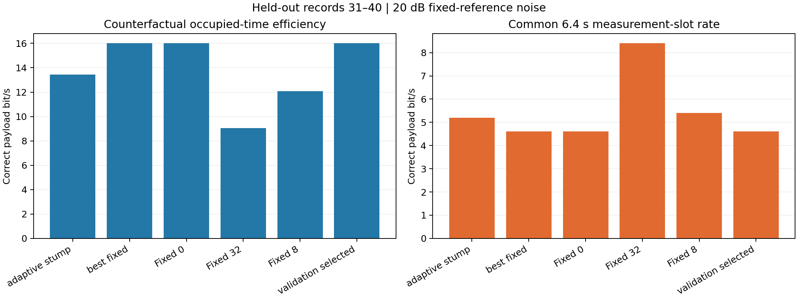
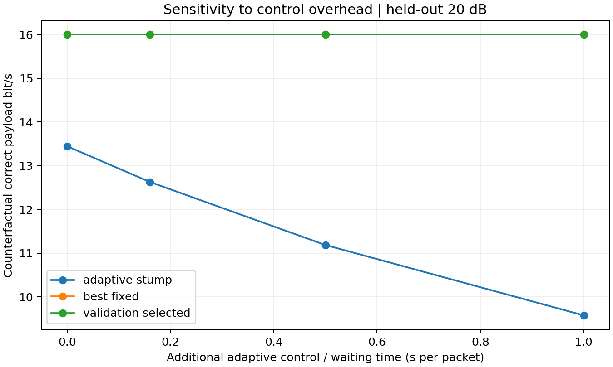

# 自适应保护时间 V2：冻结规则后的留出评测

在预设主条件 20 dB 下，本轮自适应规则没有超过开发集选定的最佳固定策略。结论基于同一测量序列中预先留出的 031–040 号记录；不能据此声称任意海域上的泛化或真实反馈链路已完成。

## 已锁定的方法

- 有效发射时间 8 ms，保护时间候选 0/4/8/16/32 ms；主条件为 20 dB 的同记录固定噪声参考。
- 训练 001–005、验证 006–010；最终 031–040。冻结时间：2026-11-02T08:16:02.279938+00:00。
- 固定基线：始终选择 0 ms。
- 最佳非恒定候选：上一包 sync_score ≤ 0.499815 时选 0 ms，否则选 8 ms；首包、上一包捕获失败或特征缺失时回退 8 ms。
- 验证选择：`fixed_0`；始终选择 0 ms。
- 使用上一包实际选择的保护时间对应的前导估计，没有免费的额外 probe，没有用当前包真值选择可部署策略。真实信道名称和 V0 不作为策略特征。

## 最终结果

|策略|反事实占用效率 bit/s|共同槽位载荷率 bit/s|条件 BER|捕获丢失率|包失败率|
|---|---:|---:|---:|---:|---:|
|adaptive_stump|13.447|5.200|9.578%|0.00%|74.00%|
|best_fixed|16.000|4.600|12.687%|0.00%|77.00%|
|fixed_0|16.000|4.600|12.687%|0.00%|77.00%|
|fixed_32|9.057|8.400|1.203%|0.00%|58.00%|
|fixed_8|12.067|5.400|5.789%|0.00%|73.00%|
|oracle_current_outcomes|22.846|9.200|9.641%|0.00%|54.00%|
|validation_selected|16.000|4.600|12.687%|0.00%|77.00%|

反事实占用效率分母为发射前导/导频、载荷、保护时间、包尾加统一 0.16 s 理想控制预算；共同槽位载荷率保留每个 6.4 s 实验槽位的全部时间。两者分别回答不同问题。规则选择基于前者，后者保证实验空闲没有被隐去。连续链路在选择不同保护时间后会经历不同信道时刻，需要另行连续时序验证。

`oracle_current_outcomes` 预先知道当前包所有候选的结果，仅作为不可实现参考。条件 BER 只统计已捕获并得到判决的载荷，捕获失败以擦除和包失败单独计入。无错包的判断来自仿真真值，未声称已实现 CRC。

### 分信道检查

|信道|策略|占用效率 bit/s|槽位载荷率 bit/s|包失败率|
|---|---|---:|---:|---:|
|NCS1|adaptive_stump|0.000|0.000|100.00%|
|NOF1|adaptive_stump|24.465|10.400|48.00%|
|NCS1|best_fixed|0.000|0.000|100.00%|
|NOF1|best_fixed|32.000|9.200|54.00%|

总体效率不能替代困难信道的可靠性：包失败率为 100% 表示这批包没有完整正确接收，不能因为同步已捕获就称通信已经可靠。

### 冻结模型的噪声鲁棒性

|噪声标签 dB|策略|占用效率 bit/s|槽位载荷率 bit/s|包失败率|
|---:|---|---:|---:|---:|
|0|adaptive_stump|11.923|4.000|80.00%|
|10|adaptive_stump|13.316|5.000|75.00%|
|20|adaptive_stump|13.447|5.200|74.00%|
|0|best_fixed|11.826|3.400|83.00%|
|10|best_fixed|14.609|4.200|79.00%|
|20|best_fixed|16.000|4.600|77.00%|

这些信噪比均使用相同冻结模型，未分别重新调参。

## 差值与开销

- `adaptive_stump` 相对开发集选定的 `best_fixed`，占用效率差值 -2.553 bit/s；按记录配对重采样的 2.5%–97.5% 范围为 [-6.212, +0.795] bit/s。共同槽位载荷率差值 +0.600 bit/s。
- `validation_selected` 相对开发集选定的 `best_fixed`，占用效率差值 +0.000 bit/s；按记录配对重采样的 2.5%–97.5% 范围为 [+0.000, +0.000] bit/s。共同槽位载荷率差值 +0.000 bit/s。

重采样在两个信道内分别按整条记录抽取，两个策略使用相同抽样记录，重复 2,000 次。相邻记录仍可能相关，这些范围是记录重采样敏感性结果，不是跨环境保证。

所有方案已有 0.16 s/包的理想 ACK/模式通知预算；图中再仅给自适应增加 0、0.16、0.5、1.0 s。该图在相同包结果上重算时间分母，没有重新模拟多等待后的信道变化。这里没有测试回传物理链路，也没有假定这些数值覆盖任意水声传播距离。完整数值在 `control_overhead.csv`。

## 可核查结果

- `frozen_policy.json`：规则、候选评分、开发数据与协议哈希；拟合不读取最终文件。
- `development_scores.csv`：训练和验证候选表现。
- `selected_packets.csv`：每包动作、上一包特征、错误/擦除与时间预算。
- `test_summary.csv`、`test_by_channel.csv`、`test_by_record.csv`：总体、分信道与分记录结果。
- `paired_record_resampling.csv`：配对记录重采样差值。
- `evaluation.json`：最终数据源、哈希、冻结模型哈希和前导跨动作差异审计。

本报告固定使用冻结规则，不因最终结果而修改阈值或选取更有利的记录。两条测量序列中的估计速度、时延特征与信道身份可能相关，学到的阈值不能解释成普适的声学规律。若改进未成立，当前结果就是该预设策略在本轮条件下的结论。
