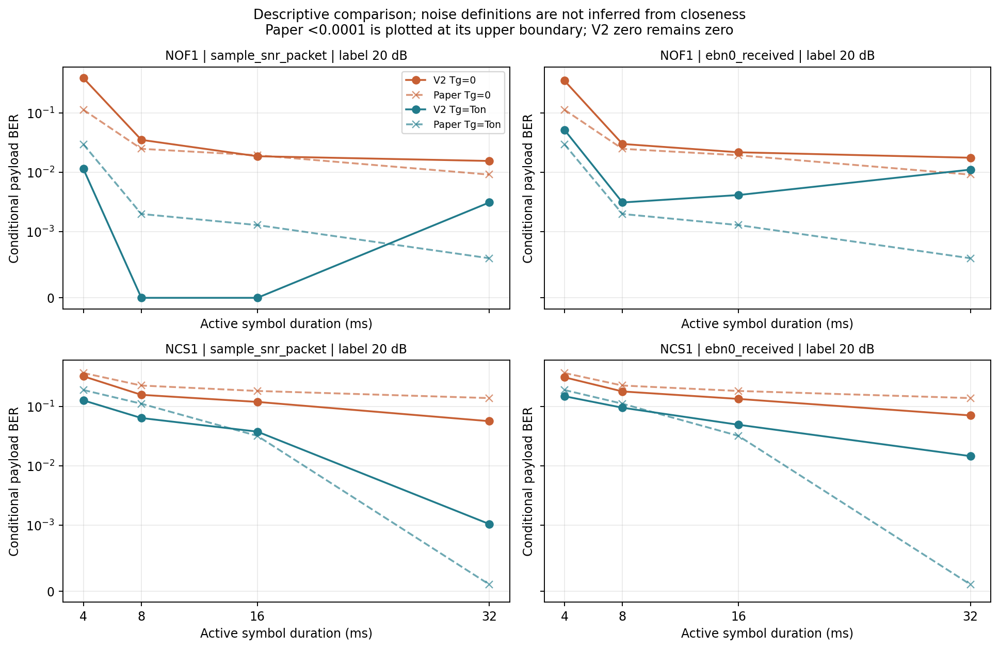
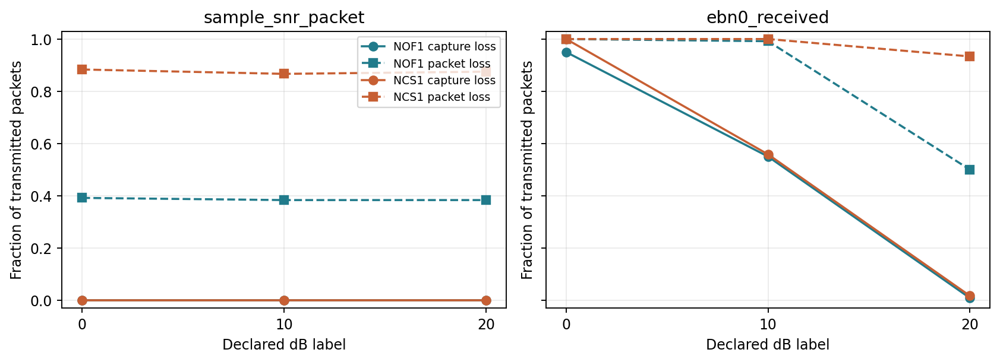
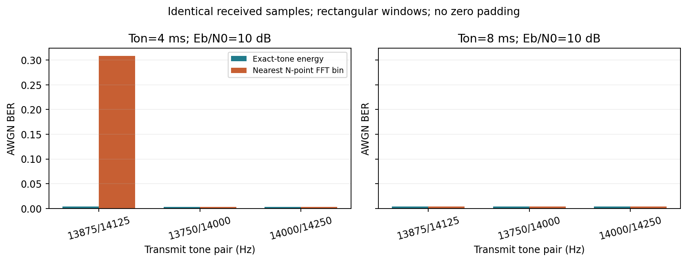

# V2 原论文参数对齐诊断

> 后续诊断已完成：本文件保留原 V2 数值。NOF1 4 ms 无保护的异常高误码，已由同一波形上的定时消融定位到最早前导峰窗口与符号相位复位的交互；主峰定时候选将 373/960 降为 24/960。详见 [V3 原因诊断](../../v3/nof1_diagnostic/report.md)，其中另有 004–005 开发记录确认及尚未解决的偏差。下文“待验证解释”反映 V2 当时的状态。

本次为开发数据上的描述性诊断（阶段 `full`），使用 NCS1/NOF1 的 001、002、003 记录，**未读取最终留出 031–040**。完整诊断与原文相同的是信道名称、250 Hz 双音间隔、4/8/16/32 ms 有效发射时间解释、无保护/等长保护，以及 0/10/20 dB 标签；包长、频率位置、前导与导频、相位、同步、噪声含义仍包含自行指定的条件，不能称为精确数值复现。

**仍有明显未对齐：NOF1、4 ms、无保护、`sample_snr_packet`、20 dB，本次条件 BER 为 373/960=0.38854，原文为 0.1137，绝对差 0.27484。** 不能仅凭 8 ms 等长保护等条件接近原表，就认为整体数值已经对齐。

## 尚未对齐的幅度

下表按两种噪声定义分别汇总。MAE 是各可比条件的条件 BER 绝对差等权平均，只纳入原文给出精确 BER 且本次至少有一个载荷获得判决的条件；不把 `<0.0001` 当成精确值，也不替无判决条件补零。无 BER 条件数与原文界限条件数可能重叠。

|noise_mode|all_conditions|exact_reference_conditions|compared_exact_conditions|no_decoded_ber_conditions|paper_upper_bound_conditions|mean_absolute_ber_difference|max_absolute_ber_difference|
|---|---|---|---|---|---|---|---|
|ebn0_received|48|45|34|12|3|0.12748|0.63092|
|sample_snr_packet|48|45|45|0|3|0.046506|0.27891|

各噪声定义下绝对差最大的可比条件为：

|noise_mode|channel|on_ms|guard_ms|snr_label_db|bit_errors|decoded_bits|conditional_ber|paper_ber_reported|absolute_ber_difference|capture_loss|
|---|---|---|---|---|---|---|---|---|---|---|
|ebn0_received|NOF1|32|0|0|41|64|0.64062|0.0097|0.63092|0.93333|
|sample_snr_packet|NOF1|4|0|10|377|960|0.39271|0.1138|0.27891|0|

`ebn0_received` 的最大偏差条件只解出 1 包，失锁 14/15 包，条件 BER 使用 64 bit；它不能代表全部发送载荷的误码率。 MAE 也不计入失锁代价，且两口径可比较条件集合不同，不能用 MAE 排名来认定原论文采用了哪种噪声定义。失锁及整包损失仍须与下文一起看。

一个**待验证解释**是定时参考不同：本接收器按收到的 HFM 相关图中首个显著路径确定载荷窗，而平均 PDP 峰、相关最强路径及 oracle 的参考并不必然指向同一时刻。相同时移占 4 ms 符号的比例更大，可能使短符号结果更敏感；当前数据尚未隔离这一因素，不能断言它已解释上述偏差。还需要在相同接收波形上比较这些参考的定时偏移及误码关联，才能判断其贡献。本次没有为此修改接收器或选择新的频率。

## 本次样本和接收链路

- 1440 个包级观测；完整运行应为 96 个条件，每条件 3 条记录 × 5 包 × 64 bit = 960 个发送载荷 bit。
- 每包在 6.4 s 完整监听槽内具有 0.12–0.34 s 随机未知起点；所有候选共用载荷、起点、随机载波相位及标准正态噪声向量。符号相位重置为该包相位。
- `replayfilter_fast` 后按官方 `alpha=1/(1-V0/1500)` **逐槽恢复整体时间尺度**。每个槽的局部时间原点独立，因此本对齐诊断不声称复现整段 32 s 连续传播的累计漂移。接收器只获取收到的波形、公开帧配置和载荷长度；真实 TVIR、V0、起点、载荷不输入接收器。
- HFM 包含 64 ms UP、64 ms 间隔及 64 ms DOWN，扫频 10–18 kHz；另加两个 64 ms 已知双音导频和保护段，载荷标称偏移 528 ms。后者和频带/加窗是本项目选择。
- 接收器必需自检 71/71 PASS。这里没有按诊断 BER 调捕获阈值或调发射频率。

运行中 MATLAB R2020b 进程在 960 条完整观测落盘后出现 `0xc0000374 Heap corruption`。按完整配置检查点续跑剩余记录；没有修改实验条件、种子、噪声公式或接收器。恢复范围和原检查点 SHA256 保存在 `runtime_recovery.json`。这次进程恢复不涉及最终留出数据。

## 两种噪声定义及结果

令 `E=sum(clean_slot.^2)`，包括前导、导频、载荷和信道拖尾；`L=ceil(alpha*(完整发送帧时长+128 ms尾段)*fs)`，排除随机监听前后背景。

1. `sample_snr_packet`：`sigma²=E/L/10^(label/10)`，含前导、保护和尾段的整帧平均功率。保护时间改变 L，因此也会改变噪声；它不是固定噪声的纯保护时间对照。
2. `ebn0_received`：`sigma²=E/(2*64*10^(label/10))`，整帧接收能量按 64 个信息 bit 分摊，明确计入前导和导频能量。这与按载荷有效能量定义的 Eb/N0 也不同。

同一条件的两个方差满足 `sigma²_EbN0/sigma²_sample=L/(2*64)`，本报告脚本已逐包验证。**原论文仅给 SNR 标签；下面的差异不能用于反推其未披露的噪声实现。**

|noise_mode|snr_label_db|packets|bit_errors|decoded_bits|conditional_ber|capture_loss|packet_loss|
|---|---|---|---|---|---|---|---|
|ebn0_received|0|240|193|384|0.5026|0.975|1|
|ebn0_received|10|240|1336|6848|0.19509|0.55417|0.99583|
|ebn0_received|20|240|1422|15168|0.09375|0.0125|0.71667|
|sample_snr_packet|0|240|1326|15360|0.086328|0|0.6375|
|sample_snr_packet|10|240|1314|15360|0.085547|0|0.625|
|sample_snr_packet|20|240|1299|15360|0.08457|0|0.62917|

条件 BER 仅以实际得到判决的载荷 bit 为分母；捕获失败仍计入包损失并记录 64 bit 擦除，不把擦除虚构成误码或零误码。共有 12 个条件完全没有已判决 bit，其条件 BER 记 NA。`capture_loss` 指接收器未输出完整载荷，并未另行通过真值验证多径中的定时关联正确率；已返回但错误的载荷进入误码和包损失。

观察到 5 个有判决且零比特错误的条件；这不证明真实 BER=0。每条件最多只有 960 bit，单个错误的分辨率为 1/960≈0.00104，远不足以确认原表 `<0.0001` 的水平。位、包、相邻记录相关，因此没有把 960 bit 当成独立信道样本计算置信区间；`per_record_summary.csv` 保留 3 条记录各自结果。

## FFT bin 对齐诊断

单独的 AWGN 实验在同一接收采样波形上比较精确双音能量与无补零 N 点矩形窗 FFT 的最近一个频点；最近 bin 半整数按 MATLAB `round` 向上取整，判决能量相等时选 0。不是原文未披露的窄带积分实现。三组频率事先固定，所有频率组共用比特、逐符号随机相位和噪声实现。每个配置 20000 bit。

|on_ms|f0_hz|f1_hz|bits|exact_errors|fft_errors|exact_ber|fft_ber|
|---|---|---|---|---|---|---|---|
|4|13875|14125|20000|74|6169|0.0037|0.30845|
|4|13750|14000|20000|68|68|0.0034|0.0034|
|4|14000|14250|20000|64|64|0.0032|0.0032|
|8|13875|14125|20000|74|74|0.0037|0.0037|
|8|13750|14000|20000|87|87|0.00435|0.00435|
|8|14000|14250|20000|84|84|0.0042|0.0042|

13,875/14,125 Hz 在 4 ms 时为 55.5/56.5 个周期，在 8 ms 为 111/113 整数周期；较低、较高两组在这两种时长均落在整 bin。4 ms 下最近-bin 对称频率可能把一个音的能量分散到两个候选 bin，结果还取决于半-bin 舍入与有限窗相位；精确频率相关不受同一种频点舍入限制。补零可以细化采样网格，但不增加观察时长决定的频率分辨率。

这个实验隔离了检测器与 bin 位置关系；若在 Watermark 实测信道中改发射频率，也会改变频率选择性衰落，不能把变化全部归给 FFT。未在留出数据上挑频率，也不根据与原表接近的程度选择噪声定义。

## 原文证据边界

[2024 主论文](https://vibsys.put.poznan.pl/_journal/2024-35-2/articles/vps_2024207.pdf)介绍 HFM-UP/HFM-DOWN 前导和 FFT/窄带判决；第 6 页将 BFSK 的 FFT 输入点数 N 与 Ts 内的采样点数关联，FFH 则与 Th 内采样关联，不能说其完全没有交代点数关系。它仍没有给出实际采样率、具体窗型、补零设置、窄频带边界及完整频带统计实现，也没有披露 HFM 具体时长、双音绝对频率、逐符号相位策略、完整捕获设置或噪声归一化。[2023 引用同步论文](https://vibsys.put.poznan.pl/_journal/2023-34-1/articles/vps_2023102.pdf)提供 64 ms 脉冲与 64 ms 间隔示例，不代表主论文采用了相同参数；其印刷的多普勒表达式存在量纲/零速解释疑点，本项目没有直接照抄，而以公开导频估计时间尺度并通过正负速度合成测试核验。详见 `docs/protocol_v2_review.md` 和 `docs/paper_audit.md`。

完整 48 行原表在两种噪声定义下分别对照，写入 `paper_comparison_all_conditions.csv`，原文三条 `<0.0001` 原样保留且不计算精确差值。下面全量列出；所有结果均是本次已披露假设下的实验观察。

|channel|noise_mode|on_ms|guard_ms|snr_label_db|paper_ber_reported|bit_errors|decoded_bits|conditional_ber|capture_loss|packet_loss|
|---|---|---|---|---|---|---|---|---|---|---|
|NCS1|ebn0_received|4|0|0|0.3743|0|0|NA|1|1|
|NCS1|sample_snr_packet|4|0|0|0.3743|296|960|0.30833|0|1|
|NCS1|ebn0_received|4|0|10|0.3743|269|704|0.3821|0.26667|1|
|NCS1|sample_snr_packet|4|0|10|0.3743|304|960|0.31667|0|1|
|NCS1|ebn0_received|4|0|20|0.3643|296|960|0.30833|0|1|
|NCS1|sample_snr_packet|4|0|20|0.3643|308|960|0.32083|0|1|
|NCS1|ebn0_received|4|4|0|0.1958|0|0|NA|1|1|
|NCS1|sample_snr_packet|4|4|0|0.1958|122|960|0.12708|0|1|
|NCS1|ebn0_received|4|4|10|0.1892|201|704|0.28551|0.26667|1|
|NCS1|sample_snr_packet|4|4|10|0.1892|124|960|0.12917|0|0.93333|
|NCS1|ebn0_received|4|4|20|0.1883|142|960|0.14792|0|0.93333|
|NCS1|sample_snr_packet|4|4|20|0.1883|121|960|0.12604|0|1|
|NCS1|ebn0_received|8|0|0|0.2298|0|0|NA|1|1|
|NCS1|sample_snr_packet|8|0|0|0.2298|150|960|0.15625|0|1|
|NCS1|ebn0_received|8|0|10|0.2243|176|640|0.275|0.33333|1|
|NCS1|sample_snr_packet|8|0|10|0.2243|150|960|0.15625|0|1|
|NCS1|ebn0_received|8|0|20|0.2240|171|960|0.17813|0|1|
|NCS1|sample_snr_packet|8|0|20|0.2240|150|960|0.15625|0|1|
|NCS1|ebn0_received|8|8|0|0.1167|0|0|NA|1|1|
|NCS1|sample_snr_packet|8|8|0|0.1167|70|960|0.072917|0|1|
|NCS1|ebn0_received|8|8|10|0.1120|165|640|0.25781|0.33333|1|
|NCS1|sample_snr_packet|8|8|10|0.1120|66|960|0.06875|0|1|
|NCS1|ebn0_received|8|8|20|0.1107|91|960|0.094792|0|1|
|NCS1|sample_snr_packet|8|8|20|0.1107|61|960|0.063542|0|1|
|NCS1|ebn0_received|16|0|0|0.1835|0|0|NA|1|1|
|NCS1|sample_snr_packet|16|0|0|0.1835|120|960|0.125|0|1|
|NCS1|ebn0_received|16|0|10|0.1816|72|320|0.225|0.66667|1|
|NCS1|sample_snr_packet|16|0|10|0.1816|115|960|0.11979|0|1|
|NCS1|ebn0_received|16|0|20|0.1815|128|960|0.13333|0|1|
|NCS1|sample_snr_packet|16|0|20|0.1815|114|960|0.11875|0|1|
|NCS1|ebn0_received|16|16|0|0.0328|0|0|NA|1|1|
|NCS1|sample_snr_packet|16|16|0|0.0328|40|960|0.041667|0|1|
|NCS1|ebn0_received|16|16|10|0.0319|49|256|0.19141|0.73333|1|
|NCS1|sample_snr_packet|16|16|10|0.0319|38|960|0.039583|0|0.93333|
|NCS1|ebn0_received|16|16|20|0.0318|47|960|0.048958|0|1|
|NCS1|sample_snr_packet|16|16|20|0.0318|36|960|0.0375|0|0.93333|
|NCS1|ebn0_received|32|0|0|0.1390|0|0|NA|1|1|
|NCS1|sample_snr_packet|32|0|0|0.1390|55|960|0.057292|0|1|
|NCS1|ebn0_received|32|0|10|0.1378|8|64|0.125|0.93333|1|
|NCS1|sample_snr_packet|32|0|10|0.1378|53|960|0.055208|0|0.93333|
|NCS1|ebn0_received|32|0|20|0.1377|63|896|0.070312|0.066667|1|
|NCS1|sample_snr_packet|32|0|20|0.1377|54|960|0.05625|0|1|
|NCS1|ebn0_received|32|32|0|<0.0001|0|0|NA|1|1|
|NCS1|sample_snr_packet|32|32|0|<0.0001|1|960|0.0010417|0|0.066667|
|NCS1|ebn0_received|32|32|10|<0.0001|5|64|0.078125|0.93333|1|
|NCS1|sample_snr_packet|32|32|10|<0.0001|2|960|0.0020833|0|0.13333|
|NCS1|ebn0_received|32|32|20|<0.0001|13|896|0.014509|0.066667|0.53333|
|NCS1|sample_snr_packet|32|32|20|<0.0001|1|960|0.0010417|0|0.066667|
|NOF1|ebn0_received|4|0|0|0.1338|36|64|0.5625|0.93333|1|
|NOF1|sample_snr_packet|4|0|0|0.1338|381|960|0.39687|0|1|
|NOF1|ebn0_received|4|0|10|0.1138|123|832|0.14784|0.13333|1|
|NOF1|sample_snr_packet|4|0|10|0.1138|377|960|0.39271|0|1|
|NOF1|ebn0_received|4|0|20|0.1137|337|960|0.35104|0|0.86667|
|NOF1|sample_snr_packet|4|0|20|0.1137|373|960|0.38854|0|1|
|NOF1|ebn0_received|4|4|0|0.0352|32|64|0.5|0.93333|1|
|NOF1|sample_snr_packet|4|4|0|0.0352|17|960|0.017708|0|0.46667|
|NOF1|ebn0_received|4|4|10|0.0305|96|832|0.11538|0.13333|1|
|NOF1|sample_snr_packet|4|4|10|0.0305|13|960|0.013542|0|0.4|
|NOF1|ebn0_received|4|4|20|0.0298|50|960|0.052083|0|0.66667|
|NOF1|sample_snr_packet|4|4|20|0.0298|11|960|0.011458|0|0.4|
|NOF1|ebn0_received|8|0|0|0.0270|29|64|0.45312|0.93333|1|
|NOF1|sample_snr_packet|8|0|0|0.0270|35|960|0.036458|0|0.46667|
|NOF1|ebn0_received|8|0|10|0.0253|61|576|0.1059|0.4|1|
|NOF1|sample_snr_packet|8|0|10|0.0253|35|960|0.036458|0|0.46667|
|NOF1|ebn0_received|8|0|20|0.0250|29|960|0.030208|0|0.46667|
|NOF1|sample_snr_packet|8|0|20|0.0250|34|960|0.035417|0|0.46667|
|NOF1|ebn0_received|8|8|0|0.0032|27|64|0.42188|0.93333|1|
|NOF1|sample_snr_packet|8|8|0|0.0032|1|960|0.0010417|0|0.066667|
|NOF1|ebn0_received|8|8|10|0.0021|43|512|0.083984|0.46667|0.93333|
|NOF1|sample_snr_packet|8|8|10|0.0021|0|960|0|0|0|
|NOF1|ebn0_received|8|8|20|0.0020|3|960|0.003125|0|0.2|
|NOF1|sample_snr_packet|8|8|20|0.0020|0|960|0|0|0|
|NOF1|ebn0_received|16|0|0|0.0223|28|64|0.4375|0.93333|1|
|NOF1|sample_snr_packet|16|0|0|0.0223|20|960|0.020833|0|0.6|
|NOF1|ebn0_received|16|0|10|0.0197|39|384|0.10156|0.6|1|
|NOF1|sample_snr_packet|16|0|10|0.0197|18|960|0.01875|0|0.6|
|NOF1|ebn0_received|16|0|20|0.0195|21|960|0.021875|0|0.53333|
|NOF1|sample_snr_packet|16|0|20|0.0195|18|960|0.01875|0|0.6|
|NOF1|ebn0_received|16|16|0|0.0022|0|0|NA|1|1|
|NOF1|sample_snr_packet|16|16|0|0.0022|0|960|0|0|0|
|NOF1|ebn0_received|16|16|10|0.0015|29|320|0.090625|0.66667|1|
|NOF1|sample_snr_packet|16|16|10|0.0015|0|960|0|0|0|
|NOF1|ebn0_received|16|16|20|0.0013|4|960|0.0041667|0|0.2|
|NOF1|sample_snr_packet|16|16|20|0.0013|0|960|0|0|0|
|NOF1|ebn0_received|32|0|0|0.0097|41|64|0.64062|0.93333|1|
|NOF1|sample_snr_packet|32|0|0|0.0097|16|960|0.016667|0|0.4|
|NOF1|ebn0_received|32|0|10|0.0098|0|0|NA|1|1|
|NOF1|sample_snr_packet|32|0|10|0.0098|16|960|0.016667|0|0.4|
|NOF1|ebn0_received|32|0|20|0.0092|17|960|0.017708|0|0.53333|
|NOF1|sample_snr_packet|32|0|20|0.0092|15|960|0.015625|0|0.4|
|NOF1|ebn0_received|32|32|0|0.0022|0|0|NA|1|1|
|NOF1|sample_snr_packet|32|32|0|0.0022|2|960|0.0020833|0|0.13333|
|NOF1|ebn0_received|32|32|10|0.0010|0|0|NA|1|1|
|NOF1|sample_snr_packet|32|32|10|0.0010|3|960|0.003125|0|0.2|
|NOF1|ebn0_received|32|32|20|0.0006|10|896|0.011161|0.066667|0.53333|
|NOF1|sample_snr_packet|32|32|20|0.0006|3|960|0.003125|0|0.2|
