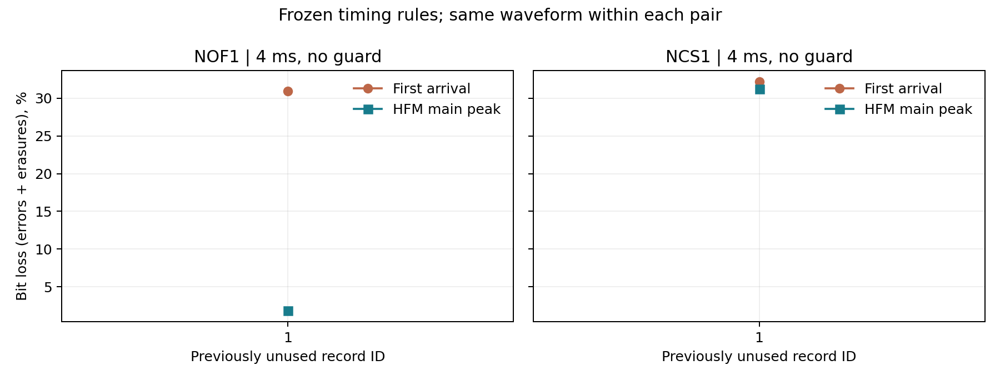

# V4 主峰定时 开发自检（001）

预定主条件 NOF1、4 ms、无保护：合计比特损失率从 **30.94%** 到 **1.88%**，下降。
首到达规则为 99 错误 + 0 擦除 / 320 bit；主峰规则为 6 错误 + 0 擦除 / 320 bit。

本轮只改有效符号积分起点；导频估计、检测器、每个配对的波形、噪声与初相相同。

## 全部预定条件

|信道|发声/保护 ms|方法|错误/已解码 bit|擦除/总 bit|条件 BER|比特损失率|错误包/总包|
|---|---|---|---|---|---|---|---|
|NCS1|4/0|首到达|103/320|0/320|32.19%|32.19%|5/5|
|NCS1|4/0|主峰|100/320|0/320|31.25%|31.25%|5/5|
|NCS1|4/4|首到达|30/320|0/320|9.38%|9.38%|5/5|
|NCS1|4/4|主峰|29/320|0/320|9.06%|9.06%|5/5|
|NCS1|8/0|首到达|42/320|0/320|13.12%|13.12%|5/5|
|NCS1|8/0|主峰|42/320|0/320|13.12%|13.12%|5/5|
|NCS1|8/8|首到达|23/320|0/320|7.19%|7.19%|5/5|
|NCS1|8/8|主峰|23/320|0/320|7.19%|7.19%|5/5|
|NOF1|4/0|首到达|99/320|0/320|30.94%|30.94%|5/5|
|NOF1|4/0|主峰|6/320|0/320|1.88%|1.88%|2/5|
|NOF1|4/4|首到达|5/320|0/320|1.56%|1.56%|3/5|
|NOF1|4/4|主峰|1/320|0/320|0.31%|0.31%|1/5|
|NOF1|8/0|首到达|9/320|0/320|2.81%|2.81%|2/5|
|NOF1|8/0|主峰|7/320|0/320|2.19%|2.19%|2/5|
|NOF1|8/8|首到达|0/320|0/320|0.00%|0.00%|0/5|
|NOF1|8/8|主峰|0/320|0/320|0.00%|0.00%|0/5|

条件 BER 只使用已解码比特；比特损失率将未捕获或不完整的整包计为 64 bit 擦除。无擦除时两者相同。PER 由错误包/总包给出。

## 逐记录配对差异

差异定义为主峰减首到达，负数表示改善；每条记录先聚合 5 包。

|信道|发声/保护 ms|改善/持平/恶化记录|差异最小值|差异中位数|差异最大值|
|---|---|---|---|---|---|
|NCS1|4/0|1/0/0|-0.94 pp|-0.94 pp|-0.94 pp|
|NCS1|4/4|1/0/0|-0.31 pp|-0.31 pp|-0.31 pp|
|NCS1|8/0|0/1/0|+0.00 pp|+0.00 pp|+0.00 pp|
|NCS1|8/8|0/1/0|+0.00 pp|+0.00 pp|+0.00 pp|
|NOF1|4/0|1/0/0|-29.06 pp|-29.06 pp|-29.06 pp|
|NOF1|4/4|1/0/0|-1.25 pp|-1.25 pp|-1.25 pp|
|NOF1|8/0|1/0/0|-0.63 pp|-0.63 pp|-0.63 pp|
|NOF1|8/8|0/1/0|+0.00 pp|+0.00 pp|+0.00 pp|

## 可支持的结论与边界

本批预定条件中，没有条件的合计比特损失率因主峰规则增加；仍应查看逐记录恶化数量，不能推断所有包或其他环境均受益。

- 这是已使用的开发记录 001 的实现自检，不是新记录泛化证据；NOF1 20 个波形、40 条方法观测与原 V3 错误数、起点和尺度逐项回归。
- 同一 Watermark 信道序列的相邻记录可能相关。表中的范围和中位数描述本批记录的离散程度，不是独立海域置信区间；不把比特当独立统计重复。
- 主条件改善只支持本条件、本噪声定义和这些记录；次要条件若恶化，必须保留并限定适用范围，不能据主条件平均数自动替换所有信道的接收器。
- 未用本轮结果修改定时参数、记录选择或自适应策略；没有新增硬件、功耗、CRC 或连续排程结论。

## 可追溯文件

- [预注册](../../../../docs/timing_holdout_protocol_v4.md)；[冻结清单](../freeze.json)。
- [逐包方法结果](per_packet.csv)、[逐记录聚合](per_record.csv)、[逐记录配对](paired_records.csv)、[条件汇总](summary.csv)。
- [运行元数据与数据 SHA-256](metadata.json)、[结果核验](verification.json)。
- 收到波形数：40；方法观测数：80。每个事件的两行拥有相同收到波形 SHA-256。
- 复跑：`addpath('matlab'); run_timing_holdout_v4('development');`（需要 JVM 和预先下载的数据）；随后 `python tools/report_timing_holdout_v4.py --development`。
