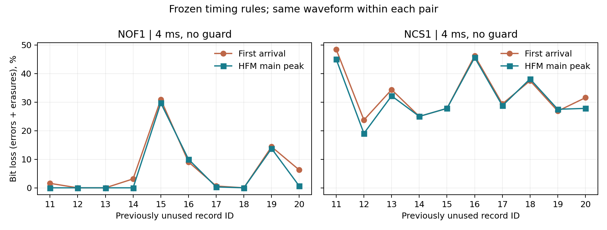

# V4 主峰定时 新记录验证（011–020）

预定主条件 NOF1、4 ms、无保护：合计比特损失率从 **6.59%** 到 **5.44%**，下降。
首到达规则为 211 错误 + 0 擦除 / 3200 bit；主峰规则为 174 错误 + 0 擦除 / 3200 bit。

本轮只改有效符号积分起点；导频估计、检测器、每个配对的波形、噪声与初相相同。

## 全部预定条件

|信道|发声/保护 ms|方法|错误/已解码 bit|擦除/总 bit|条件 BER|比特损失率|错误包/总包|
|---|---|---|---|---|---|---|---|
|NCS1|4/0|首到达|1059/3200|0/3200|33.09%|33.09%|50/50|
|NCS1|4/0|主峰|1014/3200|0/3200|31.69%|31.69%|50/50|
|NCS1|4/4|首到达|461/3200|0/3200|14.41%|14.41%|49/50|
|NCS1|4/4|主峰|440/3200|0/3200|13.75%|13.75%|49/50|
|NCS1|8/0|首到达|628/3200|0/3200|19.62%|19.62%|50/50|
|NCS1|8/0|主峰|616/3200|0/3200|19.25%|19.25%|50/50|
|NCS1|8/8|首到达|296/3200|0/3200|9.25%|9.25%|50/50|
|NCS1|8/8|主峰|291/3200|0/3200|9.09%|9.09%|50/50|
|NOF1|4/0|首到达|211/3200|0/3200|6.59%|6.59%|23/50|
|NOF1|4/0|主峰|174/3200|0/3200|5.44%|5.44%|16/50|
|NOF1|4/4|首到达|73/3200|0/3200|2.28%|2.28%|8/50|
|NOF1|4/4|主峰|75/3200|0/3200|2.34%|2.34%|9/50|
|NOF1|8/0|首到达|70/3200|0/3200|2.19%|2.19%|13/50|
|NOF1|8/0|主峰|65/3200|0/3200|2.03%|2.03%|13/50|
|NOF1|8/8|首到达|31/3200|0/3200|0.97%|0.97%|11/50|
|NOF1|8/8|主峰|26/3200|0/3200|0.81%|0.81%|10/50|

条件 BER 只使用已解码比特；比特损失率将未捕获或不完整的整包计为 64 bit 擦除。无擦除时两者相同。PER 由错误包/总包给出。

## 逐记录配对差异

差异定义为主峰减首到达，负数表示改善；每条记录先聚合 5 包。

|信道|发声/保护 ms|改善/持平/恶化记录|差异最小值|差异中位数|差异最大值|
|---|---|---|---|---|---|
|NCS1|4/0|6/2/2|-4.69 pp|-0.63 pp|+0.63 pp|
|NCS1|4/4|7/1/2|-2.19 pp|-0.47 pp|+0.31 pp|
|NCS1|8/0|6/4/0|-1.25 pp|-0.31 pp|+0.00 pp|
|NCS1|8/8|5/2/3|-1.25 pp|-0.16 pp|+0.63 pp|
|NOF1|4/0|6/3/1|-5.62 pp|-0.47 pp|+0.94 pp|
|NOF1|4/4|2/7/1|-1.25 pp|+0.00 pp|+2.19 pp|
|NOF1|8/0|2/8/0|-1.25 pp|+0.00 pp|+0.00 pp|
|NOF1|8/8|3/6/1|-1.56 pp|+0.00 pp|+0.62 pp|

## 可支持的结论与边界

合计比特损失率恶化的预定条件：NOF1 4/4 ms（2.28% → 2.34%）。主峰规则不能据本轮结果作为全条件统一改进。

- 这是冻结规则后的新记录评测；011–020 未参与此前开发，021–030 继续保留。001–010 和旧评测 031–040 不参与最终统计。
- 同一 Watermark 信道序列的相邻记录可能相关。表中的范围和中位数描述本批记录的离散程度，不是独立海域置信区间；不把比特当独立统计重复。
- 主条件改善只支持本条件、本噪声定义和这些记录；次要条件若恶化，必须保留并限定适用范围，不能据主条件平均数自动替换所有信道的接收器。
- 未用本轮结果修改定时参数、记录选择或自适应策略；没有新增硬件、功耗、CRC 或连续排程结论。

## 可追溯文件

- [预注册](../../../docs/timing_holdout_protocol_v4.md)；[冻结清单](freeze.json)。
- [逐包方法结果](per_packet.csv)、[逐记录聚合](per_record.csv)、[逐记录配对](paired_records.csv)、[条件汇总](summary.csv)。
- [运行元数据与数据 SHA-256](metadata.json)、[结果核验](verification.json)。
- 收到波形数：400；方法观测数：800。每个事件的两行拥有相同收到波形 SHA-256。
- 复跑：`addpath('matlab'); run_timing_holdout_v4('final');`（需要 JVM 和预先下载的数据）；随后 `python tools/report_timing_holdout_v4.py`。
