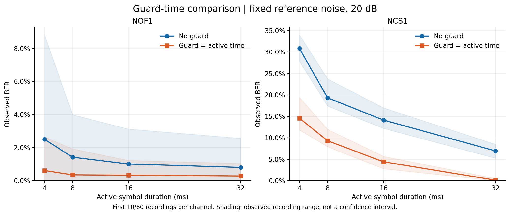
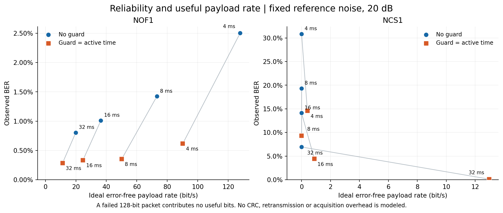
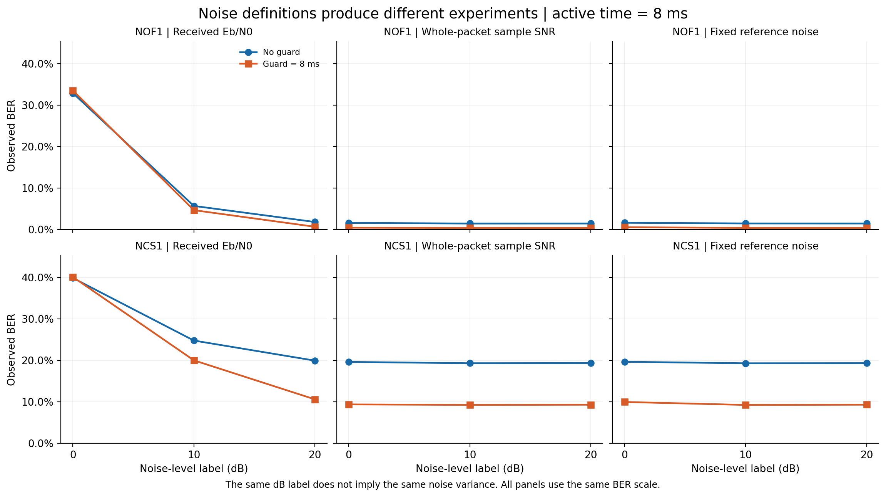

# 水声 BFSK 保护时间：有限范围复现报告

生成时间：2026-11-02 07:25 UTC。运行状态已核验为 `COMPLETE_LIMITED_SCOPE`。

本轮完成两种实测时变信道上的 BFSK 保护时间实验。固定噪声参考、标签 20 dB 的 8 组配置对比中，加入等长保护时间后观察 BER 降低的有 **8/8** 组，相同的有 **0/8** 组；理想无错载荷率提高的有 **3/8** 组。误码改善与数据率改善应分别判断，不能仅凭 BER 降低认定吞吐量上升。

这是带明确时序及噪声假设的物理层实验，尚未精确复现原文所有数值，也不是完成了可部署的水声 Modem。

## 实验范围

- 论文：[Schmidt 等，2024，Performance of low-power underwater modem for shallow water communications](https://doi.org/10.21008/j.0860-6897.2024.2.07)，本轮对应表 2、表 3 的 BFSK 部分。
- 数据：Watermark 的 NOF1、NCS1，各取连续的前 **10/60** 个记录；不是全库，也不是独立抽取的海域样本。
- 波形：采样率 48 kHz，双音 13,875/14,125 Hz；有效发射时长 4/8/16/32 ms，静默保护为 0 或等于发射时长；128 bit/包；每符号相位重置为 0。
- 接收：已知包边界，以每条实测记录的平均功率时延谱峰值确定固定接收时延，再做双音正交匹配能量检测。没有自动捕获前导，也没有根据载荷真值搜索最低误码率的时延。
- 信道：保留 Watermark 时变冲激响应的残余变化；整体速度 `V0` 没有重新引入，因此不等于官方 `sfetch` 默认恢复整体多普勒后的完整链路。
- 实验量：144 个汇总配置，即 48 个原表标签配置乘以 3 种噪声定义；每配置包含 10 条信道记录。每配置实际测试比特数为 3,840 至 75,520，由包长和记录长度决定。回放及接收计算约 119.3 秒，不包括下载、前置验证与报告生成。

## 保护时间与速率

下面的主比较在每条信道记录内固定噪声方差，参考值由同一记录的 8 ms、无保护波形能量按有效发射样本数定标。该噪声在本记录的不同发射时长、保护时间之间保持一致；不同记录会分别定标，不能理解为全实验共用一种环境噪声强度。

- NOF1 的 8 ms 配置：无保护时 1.423%（510/35,840），加入 8 ms 保护后 0.354%（68/19,200）；理想无错载荷率从 73.16 变为 50.10 bit/s。
- NCS1 的 8 ms 配置：无保护时 19.328%（7,422/38,400），加入 8 ms 保护后 9.318%（1,789/19,200）；理想无错载荷率从 0.00 变为 0.00 bit/s。

图中阴影是各记录观察 BER 的最小值到最大值，属于描述性范围，不是置信区间。不同配置按各自包长铺满记录，包时刻与最终覆盖位置不同；上述比较不属于严格逐包配对的因果实验。

无错载荷率按“完全无误码的 128 bit 包所含信息量 / 所有已发送包的总时长”计算。分母包含符号保护、前端 2 ms 补零及信道尾部包间隔；未包括前导、CRC、确认、重传和收发切换开销。是否误码由仿真真值判定，所以该数值是理想无错载荷率，不是实装协议已实现的应用吞吐量。

## 噪声定义会改变实验

三种模式独立列出：

|模式|噪声方差定义|含义|
|---|---|---|
|接收端 Eb/N0|接收整包能量 / (2 × 信息比特数 × 线性 Eb/N0)|与官方 sfetch 的能量口径对应；本轮未引入其随机包偏移和整体多普勒恢复|
|整包采样 SNR|包含静默、补零、信道尾部的整包平均功率 / 线性 SNR|保护时间会影响平均功率，从而也影响噪声方差|
|同记录固定噪声|该记录 8 ms 无保护参考功率 / 线性标签值|用于同记录内比较保护时间与时长；不是跨记录统一噪声|

- NOF1，8 ms 发射与 8 ms 保护，标签 0 dB：接收端 Eb/N0 口径为 33.495%（6,431/19,200）；整包采样 SNR 口径为 0.411%（79/19,200）；固定参考噪声口径为 0.526%（101/19,200）。
- NCS1，8 ms 发射与 8 ms 保护，标签 0 dB：接收端 Eb/N0 口径为 40.109%（7,701/19,200）；整包采样 SNR 口径为 9.385%（1,802/19,200）；固定参考噪声口径为 9.969%（1,914/19,200）。

所有曲线保留独立模式名称。相同的 0/10/20 dB 数字不代表相同的噪声强度，因此不能横向把三种模式视为同一个物理条件。

## 与原论文 8 ms 关键配置对照

原文表格值如下，均为作者结果：

|信道|原表 2：8 ms，无保护，SNR 标签 20 dB|原表 3：8 ms，8 ms 保护，SNR 标签 20 dB|
|---|---|---|
|NOF1|0.0250|0.0020|
|NCS1|0.2240|0.1107|

本轮结果如下：

|信道|噪声定义，标签均为 20 dB|无保护 BER（错误数/比特数）|8 ms 保护 BER（错误数/比特数）|
|---|---|---|---|
|NOF1|接收端 Eb/N0|1.789%（641/35,840）|0.635%（122/19,200）|
|NOF1|整包采样 SNR|1.420%（509/35,840）|0.349%（67/19,200）|
|NOF1|同记录固定噪声|1.423%（510/35,840）|0.354%（68/19,200）|
|NCS1|接收端 Eb/N0|19.940%（7,657/38,400）|10.604%（2,036/19,200）|
|NCS1|整包采样 SNR|19.346%（7,429/38,400）|9.312%（1,788/19,200）|
|NCS1|同记录固定噪声|19.328%（7,422/38,400）|9.318%（1,789/19,200）|

论文只写 SNR，未充分交代噪声归一化、双音位置、FFT 检测窗、随机数据和具体信道记录。上表按相同数字标签列出，**不表示实验条件已经对齐**，也不根据接近原文的程度挑选噪声口径。接收时序、相位、检测器与信道处理等差异都可能影响数值。完整 144 行对照在 [paper_comparison_all_conditions.csv](paper_comparison_all_conditions.csv)，原文三条 `<0.0001` 仍按界限字符串保存，未替换为零。

## 统计与结论边界

本轮 144 个汇总配置均观察到错误。若某配置未观察到错误，应写成 `0/N`，不能据此声称真实 BER 等于零。所有图均使用线性观察 BER 轴，零错误点显示真实样本观察值并标注样本数，没有偷偷换成一个正数供对数作图。

相邻记录、同一包中的位错误和连续包可能相关；本轮未将它们当作独立伯努利样本给出虚假的精密置信区间。前 10 条连续记录不能证明对全部 60 条记录或其他水域普遍有效。低误码配置的样本量尤其限制了对原文 `<0.0001` 的判断。

当前可支持的结论是：在明确记录的波形、时序、信道片段和噪声定义下，保护时间改变了 BER 与有效速率的权衡，三种噪声定义也产生了不同结果。FFH、在线同步、真实多普勒补偿、低功耗 MCU 运行及水池通信均不属于本轮完成范围。

## 可核查文件

- [汇总数据](summary.csv)、[逐信道记录数据](per_sounding.csv)、[逐包数据](per_packet.csv)、[运行元数据](run_metadata.json)。
- [原文全部条件对照](paper_comparison_all_conditions.csv)；图的可编辑 SVG 与 PNG 同存于 `figures/`。
- 原始参考值：`references/paper_bfsk_reference.csv`；符号歧义与公式核验：`docs/paper_audit.md`。
